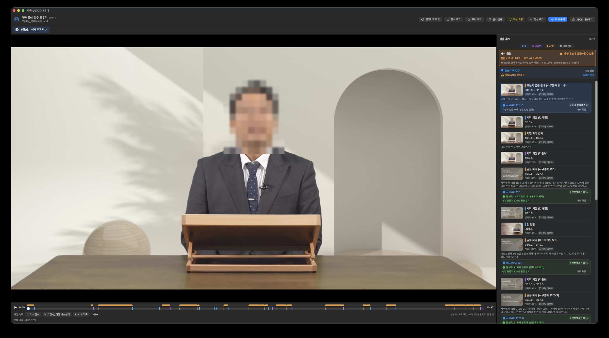

# 매묵 영상 검수 도우미

로컬 MP4/MOV/M4V 파일에서 컷, 디졸브, 화면 자막 변화 후보를 찾는 네이티브 macOS 앱입니다.

## 📥 최신 버전 다운로드

[-blue?style=for-the-badge&logo=apple)](https://github.com/Pakpakgal/gumto_helper/releases/latest/download/-0.6.1.dmg)

- **최신 릴리스 바로가기**: [GitHub Releases](https://github.com/Pakpakgal/gumto_helper/releases/latest)
- **DMG 직접 다운로드**: [MaeMook_v0.5.0.dmg 다운로드](https://github.com/Pakpakgal/gumto_helper/releases/latest/download/-0.6.1.dmg)

## 바로 사용하기

1. 다운로드한 DMG 파일을 엽니다.
2. `매묵 영상 검수 도우미.app`을 `Applications` 폴더로 드래그합니다.
3. 처음 실행할 때 macOS 보안 알림이 뜨면 앱을 **Control-클릭**하고 **열기**를 선택합니다.
4. 앱에서 **영상 추가**로 여러 영상을 선택하거나 드래그앤드롭합니다.
5. 영상은 **파일명의 날짜/이름 순서(앞선 날짜 우선)**로 자동 정렬되어 분석되며, 분석 도중 새 영상이 추가되면 현재 분석 중인 영상은 그대로 진행하고 대기열의 영상들만 날짜순으로 자동 재배열됩니다. 새로운 업데이트가 배포되면 앱 실행 시 자동으로 감지하여 **인앱 원클릭 업데이트**를 지원합니다.

## 기능

- 여러 영상을 탭으로 열고 **파일명 날짜/이름 오름차순**으로 대기열 자동 정렬 및 순차 분석 (분석 중 추가 시 대기 중인 항목 자동 재정렬)
- 별도 분석 상태 창에서 영상별 대기·진행·완료·실패 확인
- **분석 결과 로그 (오탐 리포트)** 창(⌘⇧R) 및 후보별 **오탐 리포트** 원클릭 복사·체크 기능 (`~/Library/Application Support/com.hcc.MaeMook/analysis.log`)
- **에러 로그** 창(⌘⇧L)에서 분석·음량·파일 입출력·업데이트 오류의 상세 원인(NSError 코드/도메인) 확인, 복사 및 로그 파일(`~/Library/Application Support/com.hcc.MaeMook/error.log`) 열기
- 앱 실행 시 및 상단 **업데이트 확인** 버튼으로 GitHub Releases(또는 커스텀 배포 주소)의 최신 버전을 확인하고 **"업데이트 버전이 있습니다"** 알림 및 DMG 다운로드 연결
- 작업 목록과 완료 결과를 저장해 앱을 다시 열어도 검토 가능

- 재생 프로그레스바 상단에 **자막 지속 구간(Range Bar)** 표시 및 클릭·드래그 탐색
- Space 재생/일시정지, ←/→ 3초 이동
- Q/↓ 감속, **W 정속(1.0×) ↔ 직전 배속 토글**, E/↑ 가속 재생(0.1×~10×, 피치 유지)
- 컷/디졸브/화면 자막 변화 후보 검출
- 같은 장면·유사 자막의 반복 후보 억제
- 통합 LUFS·sample peak 측정 및 YouTube 실무 기준 판정
- 성경 장·절 자막을 대한성서공회 개역개정에서 열기
- 색상 타임라인 마커와 이벤트 썸네일
- 이벤트 클릭 시 해당 시점으로 이동
- 종류별 필터와 신뢰도 표시
- 분석 결과 JSON 내보내기
- 네트워크 전송 없음
- Python·ffmpeg 등 별도 설치 불필요
- Apple Silicon과 Intel Mac을 모두 지원하는 Universal Binary

## 개발 및 배포

- 소스: `MacApp/Sources/`
- 아이콘/Asset Catalog: `MacApp/Assets.xcassets/`
- 빌드: `./MacApp/build.sh`
- 결과물: `dist/매묵 영상 검수 도우미.app`, `dist/매묵 영상 검수 도우미.dmg`

현재 배포판은 ad-hoc 서명 상태입니다. 팀 외부에 경고 없이 배포하려면 Apple Developer ID 인증서 서명과 Apple 공증이 필요합니다.

